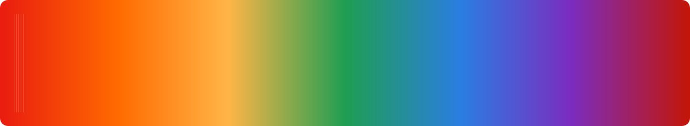

<p align="center">
  
</p>

<h1 align="center">0xMASON</h1>

<p align="center">
  <b>A human-made, responsive portfolio template.</b> Built to look and feel like an award-nominated developer portfolio — custom cursor, numbered project strip, scroll reveals, missions board, dark-mode sections and a paper-cream theme. Not AI-generated.
</p>

<p align="center">
  <a href="https://example.com/" target="_blank">
    
  </a>
  <a href="https://github.com/example/0xmason-portfolio-template" target="_blank">
    
  </a>
  
  
  
  
</p>

---

## 📖 About

**0xMASON** is a single-page portfolio template for developers, creative technologists and studios. It recreates the look, feel, animations and responsive layout of an award-nominated portfolio, but with all content and assets swapped out so _you_ own it.

It loads with a logo-marker loader, greets visitors with a custom cursor, scrolls through a numbered strip of shop-front project cards, lets visitors pick a mission, and ends with a split-screen "let's build" contact section.

### Why this doesn't feel like AI

- Opinionated, hand-written copy — no lorem ipsum, no generic "welcome to my portfolio."
- Distinctive layout (paper-cream theme, red accent, numbered strip, shop doors that open, factory crates, missions board).
- Every interaction (cursor, scroll reveal, header tuck, mission pick, crate toggle) is hand-wired with GSAP.

---

## ✨ Features (section-wise)

| Section                  | What it does                                                                              |
| ------------------------ | ----------------------------------------------------------------------------------------- |
| 🛠️ **Loader**            | Logo-marker stroke draw with a counting percentage, then fades into the page.             |
| 🧭 **Header**            | Fixed chrome with brand mark, nav underline reveal, meta email, and a mobile burger menu. |
| 📦 **Project strip**     | Numbered shop-front cards with opening doors, a peeking cat and a shine sweep on hover.   |
| 🧰 **Open-source board** | Two-panel board with pressable items and a preview pane.                                  |
| 🏙️ **Studio**            | Street-of-shops hero with sun, clouds, skyline and a scrolling lamp track.                |
| 📊 **Stats factory**     | Conveyor-belt crates that flip from raw to done, gears, belt and press.                   |
| 🎯 **Missions**          | Four pickable mission cards (web platforms, APIs, e-commerce, front-end & motion).        |
| 📬 **Contact**           | Split-screen hero with a "let's build" banner, hint arrow and mail/CTA.                   |
| 🎨 **Cursor**            | Custom dot + ring cursor with an active label on interactive elements.                    |
| 📱 **Responsive**        | Grid lines, fluid type (Archivo + JetBrains Mono), and mobile-first breakpoints.          |

---

## 🧱 Tech stack

- **HTML5** — semantic markup, skip links, ARIA landmarks
- **CSS** — custom properties (SCSS mindset), fluid typography, CSS grid/flex, `prefers-reduced-motion`
- **GSAP + ScrollTrigger** — loader, cursor, scroll reveals, header tuck, scroll progress
- **Fonts** — Archivo (variable width/weight) + JetBrains Mono via Google Fonts

> The reference portfolio runs Symfony/PHP on the back end. This template is a **static front end** (HTML/CSS/JS) so it hosts free on GitHub Pages. If you want the Symfony back end, that's a separate stack — this template is the front-end portfolio.

---

## 📂 Project structure

```
0xmason-portfolio-template/
├── index.html              # Homepage (loader, header, projects strip, missions, contact)
├── work.html               # Projects index with category filters
├── project.html            # Single case-study template (lead, stats, groups, next)
├── humans.txt              # Humans colophon
├── .gitignore              # Node, logs, dist, IDE, env
├── README.md               # This file
│
├── css/
│   └── style.css           # Full design system (tokens, components, animations)
│
├── js/
│   └── main.js             # GSAP animations (cursor, reveals, missions, rail, crates)
│
└── assets/
    ├── img/
    │   ├── project/p1..p6.jpg   # Project covers (replace with yours)
    │   ├── social-card.jpg      # Open graph / preview image
    │   ├── readme-rainbow-banner.svg
    │   ├── icon.svg             # Favicon
    │   ├── apple-touch-icon.svg
    │   └── badge/
    │       └── awwwards.svg     # Nominee badge
```

---

## 🎨 Customize it (make it yours)

1. **Name & copy** — Edit `index.html`, `work.html`, `project.html`. Swap `0xMASON`, `hello@0xmason.example`, `Lahore, PK` and all project titles/descriptions for your own.
2. **Images** — Replace `assets/img/project/p1.jpg … p6.jpg` and `assets/img/social-card.jpg` with your own screenshots (keep the same filenames, or update the `src` in the HTML).
3. **Logo** — Edit the `logo-mark` SVG paths in the HTML (header, footer, loader) to draw your own mark.
4. **Colours** — Open `css/style.css` and edit the `:root` variables (`--red`, `--bg`, `--ink`, `--amber`, …).
5. **Links** — Update `mailto:`, GitHub and social `href`s throughout.

---

## 📄 License

MIT — use it, change it, ship it. Keep the `humans.txt` credit if you like.

<p align="center">
  <b>0xMASON</b> · Hand-crafted, not generated.
</p>

<div align="ceter">

If you found this template helpful, please consider giving it a **star** ⭐! It helps others discover the repository and supports further development.

</div>
